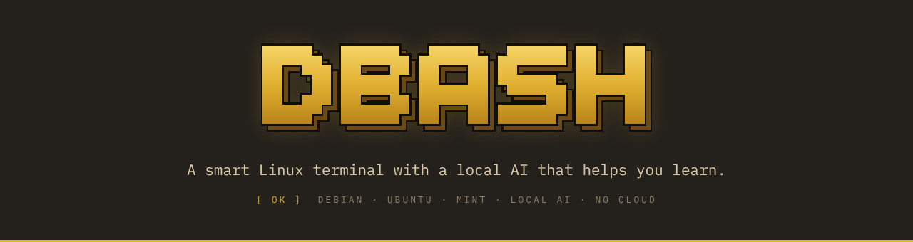
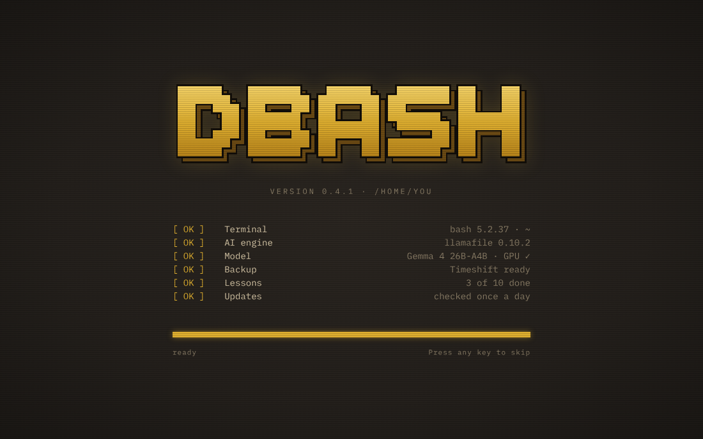
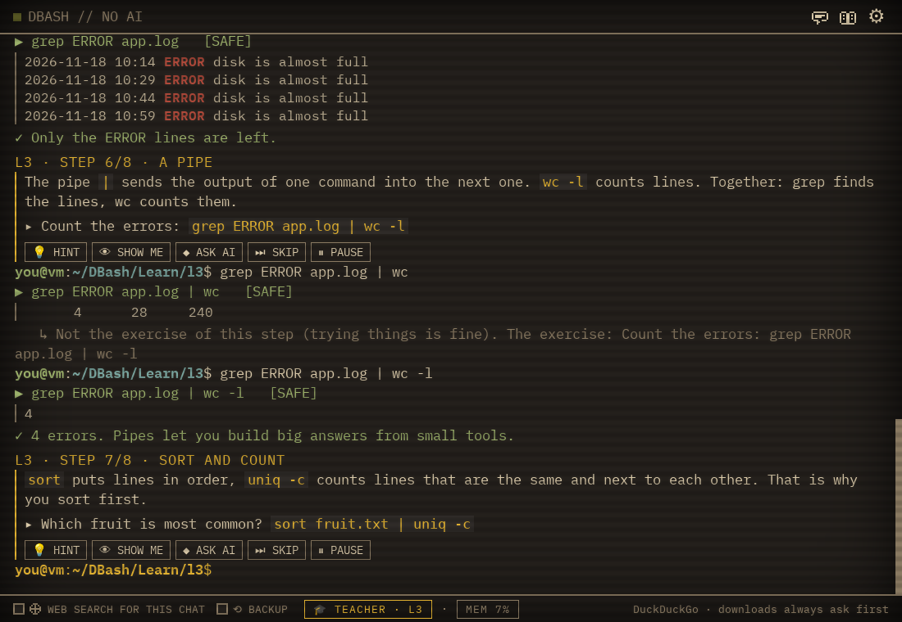
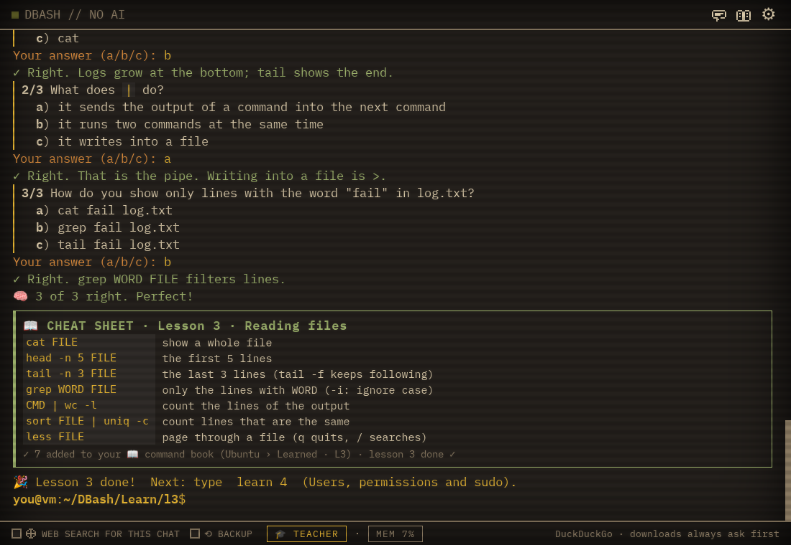
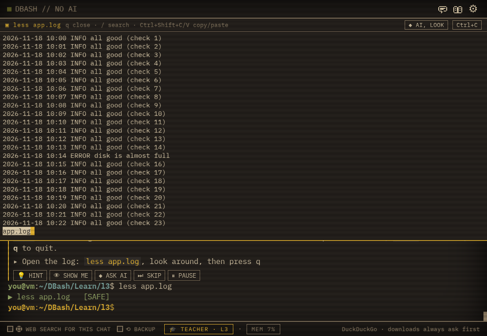

<div align="center">



**A smart Linux terminal with a local AI that helps you learn, and asks before it changes anything.**

Debian · Ubuntu · Mint · (Arch) · runs on your own PC · no cloud, no account · works offline

[⤓ Download the latest release](../../releases/latest) · [Lessons](#-learn-linux-13-checked-lessons) · [Safety](#-safety-first) · [Build it yourself](#-build-from-source)

</div>

## What is DBash?

DBash is a real terminal (bash, like in Konsole) with an AI assistant built in. The AI runs **on your own computer**, so your questions never leave your PC.

- **Ask in plain words.** For example: *is bluetooth working?*, *install Steam* or *why is my disk full?* The AI answers with real commands for **your** system, and every command gets a risk label.
- **Nothing runs by itself.** You press ▶ RUN or answer `y`. Commands that change your system always ask first, and dangerous ones ask twice.
- **Learn while you use it.** There are 13 fixed lessons with exercises that you type yourself. DBash checks them, then gives a quiz and a cheat sheet. The AI explains and gives hints when you are stuck.
- **It is also just a terminal.** `ls -la`, `cd`, `sudo apt update`, `nano`, `htop` and `ssh` work like you expect.

It is made for people who are new to Linux, or who want help without copying commands from random websites.

<div align="center">



</div>

When DBash starts, it checks in about 2 seconds what you need: the terminal, the AI engine, your model, Timeshift, your lessons and updates. Anything that is missing gets **[ !! ]** and a hint, such as *no model yet · type hf*.



## 🎓 Learn Linux: 13 checked lessons

Type `learn` in DBash and pick a lesson. The **lessons are fixed and checked**: an AI does not make them up as it goes along.

1. DBash shows one step: what it is, and the command to try.
2. **You** type it. DBash runs it in the real terminal.
3. DBash **checks the result itself**: Did it work? Are you in the right folder? Does the file exist now? Is the output right?
4. If it is right, you go to the next step. If not, you get a hint, and **👁 SHOW ME** puts the answer in the prompt.
5. At the end there is a short quiz and a cheat sheet. The cheat sheet goes into your 📖 command book.

| Quiz and cheat sheet | Full-screen programs inside DBash |
|---|---|
|  |  |

| # | Lesson | You learn |
|---|--------|-----------|
| 1 | Moving around | `pwd`, `ls -la`, `cd`, relative and absolute paths, hidden files |
| 2 | Files and folders | `mkdir`, `touch`, `>`, `>>`, `cp`, `mv`, `rm`, wildcards |
| 3 | Reading files | `cat`, `head`, `tail`, `grep`, pipes, `sort \| uniq -c`, `less` |
| 4 | Users, permissions and sudo | `ls -l`, rwx, `chmod +x`, `chmod 600`, what `sudo` really does |
| 5 | Packages | `apt search/show/install/remove`, `apt-cache policy`, `dpkg -L` |
| 6 | Services | `systemctl status`, `--failed`, `--user`, timers, unit files |
| 7 | Logs and errors | error messages, exit codes, `2>`, `journalctl`, `dmesg` |
| 8 | Disks and space | `df -h`, `lsblk`, `du \| sort -h`, `/etc/fstab`, `free -h` |
| 9 | Processes | `ps aux`, `&`, `pgrep`, `kill`, `top -b`, load average |
| 10 | Your first Bash script | variables, `for`, `if`, `nano`, `#!/bin/bash`, `$1` |
| 11 | Network | `ip -br a`, `ip route`, `ping`, DNS, `ss -tulpn`, `nmcli`, `curl -I` |
| 12 | Archives | `tar -czf`, `tar -tzf`, `tar -xzf -C`, `gzip`, `gunzip` |
| 13 | SSH and keys | `ssh-keygen`, public and private keys, fingerprints, `~/.ssh`, `ssh -G` |

All exercises happen in a practice folder (`~/DBash/Learn`). The only lesson that changes the system is lesson 5: it installs the tiny `cowsay` package and then removes it again. **Lessons work without AI.** With an AI loaded, it knows exactly which step you are on, so it explains that step and never invents another exercise.

The lessons are plain data in [`src/js/lessons.js`](src/js/lessons.js). Every check is tested for real in bash (`npm test`). Want to add or improve a lesson? See [lessons/README.md](lessons/README.md).

**Other ways the AI can help** (click 🎓 at the bottom to switch):

| Role | What it does |
|------|--------------|
| **Free** | A short answer with the commands. You run them. |
| **Explain** | The same, plus every part of every command explained. |
| **Coach** | It explains, then **you** type the command. It checks your work and gives hints, not answers. |
| **Teacher** | The lessons. |

## ✦ Features

- **◆ Local AI.** It uses [llamafile](https://github.com/mozilla-ai/llamafile) models (Gemma 4, gpt-oss, Qwen3…) on your own GPU through Vulkan (AMD, NVIDIA or Intel). Type `hf` and DBash finds the best and newest models on Hugging Face that fit your GPU, then downloads the one you pick. The list of recommended models is [`data/models.json`](data/models.json) in this repository, so it can change without a new DBash version.
- **▣ A real terminal.** It is one bash session: `cd` is remembered, output streams live, Ctrl+C stops a command, **Tab** completes file and folder names, and your own aliases from `~/.bash_aliases` work (their risk label follows what they really do). Full-screen programs (`nano`, `htop`, `less`, `ssh`) open in a panel inside DBash, and **◆ AI, LOOK** lets the AI read that screen.
- **▶ Run all, AI reads along.** You can run every command of an answer at once. It pauses at anything that changes your system. Long output folds open with the error lines on top, and the AI reads the results.
- **✎ File changes you can see.** When the AI wants to change a file, you first see the difference in colour. You answer `y`, `n`, `v` (view) or `e` (edit in nano). DBash keeps a backup, and ⟲ UNDO puts it back.
- **⟲ Backup box.** Tick it before a change and DBash makes a Timeshift snapshot. Untick it when all is well. If not, press ⟲ ROLL BACK.
- **✓ Package check.** Before an `apt install`, DBash checks that the package really exists in your sources, because small AI models sometimes invent package names.
- **🧠 AI memory.** DBash shows how full the chat is (MEM %). Old output is trimmed first, and older messages are summarized.
- **📖 Command book.** A cheat sheet for Debian, Ubuntu and Arch, plus your own commands, aliases and what you learned.
- **🌐 Web search per chat.** This is off by default. Sources are listed, and links the AI made up are marked ⚠.
- **⇪ Updates itself.** Once a day, DBash checks GitHub for a new version. It only installs one after you answer `y`, and only when the sha256 checksum matches.
- **▒ Retro look.** Pixel themes (Green, Amber, C64, IBM Blue…) and CRT effects. The fonts are built in, so nothing loads from the internet.

## 🔒 Safety first

| Label | Meaning | What DBash does |
|-------|---------|-----------------|
| **SAFE** | It only reads information | Runs right away |
| **SUDO** | It changes your system | Always asks you first, and offers a backup |
| **DANGER** | It can destroy data (`rm -r`, `dd`, `mkfs`…) | Extra confirmation, every time |
| **WEB** | It comes from an answer that used web pages | Always asks: pages can hide instructions meant for an AI |

- **The AI never runs anything by itself.** It only proposes, and you decide.
- Your **sudo password** is typed in the terminal, invisible. It stays in memory only (15 minutes by default) and is never saved to disk.
- Downloads and websites never open by themselves. Downloads only go inside your home folder.
- File changes are written only after you agree, with a backup and ⟲ UNDO.
- DBash's safety rules always come first, before your own notes and before the AI role.

More details are in [SECURITY.md](SECURITY.md).

## ⤓ Quick start

You need a 64-bit PC with Linux (it is made and tested on **Debian 13 with KDE**, and it should also work on Ubuntu, Mint and other desktops). A GPU with 8 GB or more makes the AI fast. Without one it runs on the CPU, which is slower.

1. Download **`dbash-<version>.sh`** from the [latest release](../../releases/latest).
2. Make it runnable and start it:
   ```bash
   chmod +x dbash-*.sh
   ./dbash-*.sh --menu        # starts DBash and adds it to your start menu
   ```
   It needs no root, no installation and no FUSE. The first start unpacks it once into `~/.cache/dbash`.
3. In DBash, type **`hf`** to download an AI model that fits your GPU (also in ⚙ → AI → ⤓ GET MODELS). Or type `learn` and start right away: the lessons work without AI.

Do you prefer an AppImage? `DBash-<version>-x86_64.AppImage` is in the release too, but it cannot update itself.
You can also get models without DBash: run [`scripts/dbash-get-models.sh`](scripts/dbash-get-models.sh).

**To remove it:** run `./dbash-*.sh --remove` and delete the file. Your chats, models and backups in `~/DBash` stay until you delete them yourself.

## 🛠 Build from source

```bash
# Debian / Ubuntu
sudo apt install build-essential curl libwebkit2gtk-4.1-dev libayatana-appindicator3-dev librsvg2-dev patchelf file
curl https://sh.rustup.rs -sSf | sh          # Rust
# Node.js 20 or newer

git clone <this repository> && cd dbash
npm ci
npm test                                       # lessons (for real, in bash) + the screen (jsdom)
(cd src-tauri && cargo test -- --test-threads=1)
npm run dev                                    # run it while you work on it
scripts/build.sh                               # dist/: AppImage, dbash-<version>.sh, SHA256SUMS
python3 scripts/build-preview.py               # dist/DBash-preview.html: try the screen in any browser
```

**To make a release:** put the new version in `src-tauri/Cargo.toml`, `src-tauri/tauri.conf.json` and `src/js/app.js` (`DBASH_VERSIE`), add a section to [CHANGELOG.md](CHANGELOG.md), then push a tag such as `v0.4.1`. GitHub Actions builds everything and publishes the release, and DBash installations find it the next day.

### How it is put together

```
src/                    the screen (plain HTML, CSS and JavaScript, no framework)
  index.html            layout
  css/dbash.css         look and themes
  js/lessons.js         the lesson pack (data)
  js/app.js             shared logic: chat, roles, models, command book, settings
  js/demo.js            browser preview only: simulated commands and demo answers
  js/real.js            inside the app: the real backend (terminal, sudo, files, Timeshift, updates)
  js/learn.js           runs the lessons and checks what you type
  js/splash.js          the loading screen at start
  vendor/               xterm.js (MIT) and the fonts (OFL)
src-tauri/src/main.rs   backend in Rust (Tauri 2): PTY, commands, llamafile, downloads, self-update
packaging/              header of the standalone .sh
scripts/                build, preview, model downloader
tests/                  npm test
lessons/README.md       how to write a lesson
data/models.json        the recommended AI models (DBash reads it from GitHub)
docs/                   design notes
```

Most names in the code are Dutch (`regel` = line, `voerUit` = run, `vraagAI` = ask the AI). The screen and all texts are in English, and the AI answers in the language you write in.

## 🤝 Contributing

Bug reports, lesson ideas and pull requests are welcome. See [CONTRIBUTING.md](CONTRIBUTING.md). Better lessons are the most useful thing you can add.

## Credits and license

DBash is MIT licensed (see [LICENSE](LICENSE)). It is built with [Tauri](https://tauri.app), [xterm.js](https://xtermjs.org) (MIT) and [portable-pty](https://github.com/wezterm/wezterm) (MIT). The AI runs on [llamafile](https://github.com/mozilla-ai/llamafile) by Mozilla.ai. The models come from [Hugging Face](https://huggingface.co), and each one has its own license. The fonts are VT323, IBM Plex Mono, JetBrains Mono, Press Start 2P and Share Tech Mono (SIL OFL 1.1).
